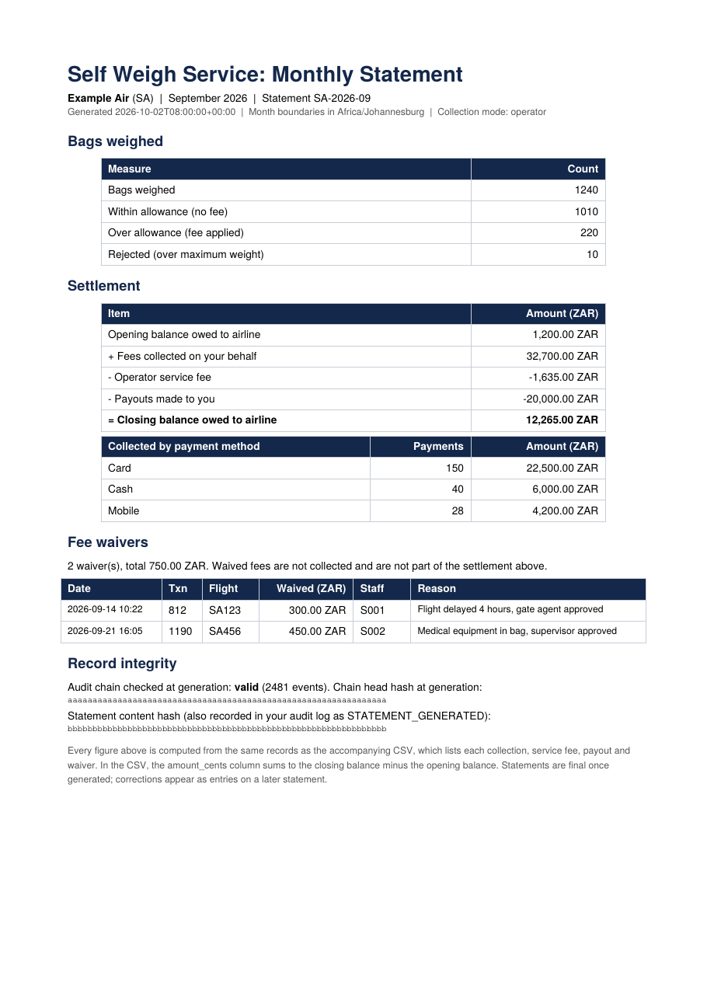

# Self Weigh Service

**Weigh. Pay. Drop.** A multi-airline backend for an airport self-service luggage weigh-and-pay kiosk.

A passenger places a bag on the scale, sees the weight against their airline's allowance, pays any
excess fee (card, mobile or cash) and proceeds to bag drop.

> Concept project. Allowances, rates and limits are illustrative defaults, not real airline or airport tariffs.

**Tech stack:** Python 3.12, FastAPI, SQLAlchemy, PostgreSQL, SQLite for local development, Docker Compose, Pydantic and ReportLab.

**Testing:** 85 automated tests passed locally using Python 3.12, with 1 deprecation warning from the Starlette/AnyIO test-client dependency. Run the suite with `.venv312\Scripts\python.exe -m pytest -q` on Windows, or `python -m pytest -q` in an environment with the project dependencies installed.

## The problem

Overweight bags are usually discovered at the bag drop counter. The passenger then repacks, moves items
into hand luggage or goes to pay at another desk, while the queue waits. Because the fee is handled by a
person, the same bag can be charged differently depending on who is serving, and fees can be settled
informally ("side deals") instead of reaching the airline.

A shared self-service weigh point moves that check before the queue, applies the **same rule to the same
weight every time**, takes payment through the system, and records every transaction. When the airport
operator collects on behalf of several airlines, a settlement ledger shows each airline exactly what was
collected, what was retained and what is owed.

This repo is the software side of that idea. The scale is simulated, so no hardware is needed to run it.

## Roadmap

- [x] **Step 0:** weigh, price and pay flow
- [x] **Step 1:** multi-airline: per-airline rules, separated records, API-key access
- [x] **Step 2:** settlement ledger and `collector` setting (airport collects vs airline collects directly)
- [x] **Step 3:** hash-chained audit log and authorised fee waivers
- [x] **Step 4:** monthly airline statements (PDF summary + CSV detail) and cash reconciliation
- [ ] **Step 5:** events and an operations dashboard
  - [x] 5a: transactional outbox and a lease-based publisher (see [Event outbox](#event-outbox))
  - [ ] 5b: queue events for payments, waivers, payouts and statements (only `TRANSACTION_WEIGHED` is queued today)
  - [ ] 5c: a worker process that runs the publisher, and a Kafka producer plus broker in Docker Compose
  - [ ] 5d: retry limits and dead-letter handling for events that keep failing
  - [ ] 5e: operations dashboard

## Flow

```
POST /weigh  ──► within allowance ──► READY_FOR_DROP
             ├─► over allowance   ──► AWAITING_PAYMENT ──POST /transactions/{id}/pay──► READY_FOR_DROP
             └─► over max / bad reading ──► REJECTED
```

## Multi-airline design

One shared database. Every airline has its own row (IATA code, allowance, max bag weight, excess rate,
currency, collector) and every transaction carries an `airline_id`.

| Role | Header | Can do |
|---|---|---|
| Admin (operator) | `X-Admin-Key` | Manage airlines and staff; view airline balances and ledgers; record payouts; generate statements; verify audit chains; reconcile cash |
| Kiosk | `X-Kiosk-Key` | Verify supplied passenger and boarding-pass details in simulation, weigh bags and record payments for any airline |
| Airline | `X-Api-Key` | Read its own profile, balance, ledger, transactions, audit log and statements |
| Staff | `X-Staff-Key` | Waive eligible fees using a personal key, with a required reason and per-person limit |

- An airline's key is shown once at creation; only its SHA-256 hash is stored.
- Asking for another airline's transaction returns 404, the same as a missing one.
- Pricing is a pure function: `quote(weight_kg, policy)`.
- In a real kiosk the airline would come from scanning the boarding pass or bag tag. Here it is passed as `airline_code`.

## Settlement ledger

Each airline has a `collector` mode:

- `operator`: the airport or kiosk operator collects, so each paid fee adds ledger entries and the
  operator later pays the airline out.
- `airline_direct`: the airline is paid at source, so nothing is owed through this ledger.

Ledger rules:
- **Append-only.** Entries are only ever added, and there are no edit or delete endpoints.
- **Balance is computed, not stored:** `balance due = payments - service fees - payouts`.
- **Atomic:** the payment and its ledger entries are saved in one database commit.
- **Exact rounding:** the operator's cut (`service_fee_bps`, default 5%) is rounded down, so the cut and the
  airline's share always add up to the fee.
- A payout cannot exceed the balance due.

| Endpoint | Role | Purpose |
|---|---|---|
| `GET /airlines/{id}/balance`, `GET /airlines/{id}/ledger` | admin | any airline's position |
| `POST /airlines/{id}/payouts` | admin | record a payout to an airline |
| `GET /airlines/me/balance`, `GET /airlines/me/ledger` | airline | its own position only |

Not yet handled: mid-period changes of collector, refunds and corrections.

## Fee waivers and the audit log

Real airports need waivers (a delayed flight, medical equipment). The risk is that waivers become the
new side deal, so they are controlled and visible:

- Only **named staff** can waive, using a personal key. Kiosk and airline keys can't.
- A **reason is required** (min. 5 characters) and the airline can see it on the transaction.
- Each person has a **waiver limit**. A fee above it is refused (403) and needs someone with a higher limit.
- A waiver only applies to a bag that is **awaiting payment**, and it creates **no ledger money**.

Every weigh, payment, waiver and payout is also written to a **hash-chained audit log**, one chain per airline:

```
hash = sha256(previous_hash + canonical_json(seq, timestamp, airline, event, actor, transaction, payload))
```

Editing, deleting or reordering any past event breaks every hash after it. `GET /airlines/me/audit/verify`
re-checks the chain and returns the first bad event if it fails. The event and the action it records are
saved in the same database commit.

**Honest limits:** this *detects* tampering, it doesn't *prevent* it. Someone with full database access could
rebuild a whole chain, and deleting the newest events would not break any later hash. The fix is to publish
the latest chain hash somewhere the operator can't edit. The monthly statement does this: it records the chain head and writes its own hash into the chain.
Restricting the database user to INSERT-only on `audit_events` would add another layer.

| Endpoint | Role | Purpose |
|---|---|---|
| `POST /staff`, `GET /staff` | admin | create staff and set their waiver limits |
| `POST /transactions/{id}/waive` | staff | waive a fee with a reason |
| `GET /airlines/me/audit`, `/audit/verify` | airline | read and verify its own chain |
| `GET /airlines/{id}/audit/verify` | admin | verify any airline's chain |

## Monthly statements

Once a month has closed, the admin generates each airline's statement. It is stored as a **frozen snapshot**
(one per airline per month, no regeneration), and the PDF and CSV are rendered from that snapshot.



- **PDF summary:** bags weighed, settlement (opening balance + collected - service fee - payouts = closing
  balance), collections by payment method, every waiver with staff ID and reason, and integrity hashes.
- **CSV detail:** every collection, service fee, payout and waiver. The `amount_cents` column sums to
  closing balance minus opening balance, so the airline can check the maths itself.
- **Anchored:** generating a statement writes a `STATEMENT_GENERATED` event with the statement's content hash
  into that airline's audit chain. The statement also records the chain head at the time, so a later edit to
  either one is detectable.
- **Safe to issue:** generation is refused if the audit chain fails verification or the month hasn't ended.
- CSV text fields are protected against spreadsheet formula injection.

Basis: money figures are by ledger date (when cash was recorded), bag counts by weigh date, and month
boundaries use `TIMEZONE` (default `Africa/Johannesburg`).

| Endpoint | Role |
|---|---|
| `POST /airlines/{id}/statements/{year}/{month}` | admin: generate (once) |
| `GET /airlines/{id}/statements/{year}/{month}[/pdf\|/csv]` | admin |
| `GET /airlines/me/statements`, `/{year}/{month}[/pdf\|/csv]` | airline: its own only |

## Cash reconciliation

Cash is the easiest money to skim, so each day the operator counts the kiosk cash boxes and submits the total:
`POST /reconciliations {business_date, counted_cents, counted_by}`. The system compares it with the fees
recorded as paid in cash that day (all airlines, any collector mode, since the cash is in the box either way)
and stores the variance. A day can only be reconciled once, and `GET /reconciliations?only_variances=true`
lists problem days. Waived and card or mobile payments are excluded.

Assumption: the kiosk takes exact cash or returns change, so cash in the box equals the fee. Real change
handling would need more design.

**Known limits and not yet built:**

- **Disputes:** No in-system workflow for challenging statement lines; airlines must raise disputes externally.
- **Refunds:** No refund workflow is implemented.
- **Per-kiosk cash tracking:** Reconciliation compares a combined total across all kiosks rather than tracking each kiosk separately.

## Event outbox

Downstream systems (the planned Kafka feed and operations dashboard) need to hear about what happens at the kiosk without the API ever claiming something happened that was not saved. The service uses a **transactional outbox**:

- **Written with the action.** `enqueue_event` adds a row to `outbox_events` in the caller's own database transaction. The transaction, its audit event and its outbox event are saved in one commit, or none of them are.
- **Delivered separately.** `publish_pending(deliver)` claims pending events, hands each one to a delivery function and records the outcome. The delivery function is a parameter, so the broker can be swapped in later without touching the outbox.
- **Safe with several workers.** Claims are short transactions. On PostgreSQL they use `FOR UPDATE SKIP LOCKED`, so two workers don't take the same event. Each claim has a lease (default 60 seconds) and a unique claim token, so a crashed worker's events become available again once the lease expires, and a worker that finishes late cannot overwrite the result of whoever took over.
- **Failures are recorded.** A failed delivery increments `attempts`, stores `last_error` and leaves the event pending for another try.
- **At-least-once.** An event can be delivered more than once (for example, if a worker dies after delivering but before recording success), so **consumers must deduplicate by event ID**.

**Current state:** only `TRANSACTION_WEIGHED` (from `POST /weigh`) is queued. Nothing runs `publish_pending` yet, and there is no Kafka client or broker in `requirements.txt` or `docker-compose.yml`. Failed events are retried indefinitely, with no backoff, retry cap or dead-letter handling. Payment, waiver, payout and statement events are not queued yet.

## Simulated passenger verification

The kiosk can compare supplied passenger details with the name and flight number entered from a boarding pass. This is a simulated comparison only; it does not contact an airline, validate a real boarding pass, or perform official identity verification.

**Endpoint:** `POST /passenger/verify`

**Authentication:** `X-Kiosk-Key`

Example using PowerShell:

```powershell
$headers = @{
    "X-Kiosk-Key" = "dev-kiosk-key"
}

$body = @{
    passenger_name = "Test Passenger"
    boarding_pass_name = "Test Passenger"
    flight_number = "SA123"
    boarding_pass_flight = "SA123"
} | ConvertTo-Json

Invoke-RestMethod `
    -Method Post `
    -Uri "http://localhost:8000/passenger/verify" `
    -Headers $headers `
    -ContentType "application/json" `
    -Body $body
```
A successful comparison returns `matched: true` and `mode: "SIMULATION"`. A name or flight mismatch returns `matched: false`. Missing or invalid kiosk authentication returns HTTP 401, while blank required details return HTTP 422.

This endpoint is a demonstration of the verification workflow, not a production identity-verification service.

## Try it

### Option 1: Interactive API documentation (recommended)

Start the application with Docker Compose:

```powershell
docker compose up --build
```
This Compose configuration uses development defaults and is intended for local testing. Do not expose it as a production deployment. Stop the services with `Ctrl+C`, then run `docker compose down` when you have finished.

Open [http://localhost:8000/docs](http://localhost:8000/docs) in your browser. The interactive documentation lets you explore endpoints and send requests without needing `curl`.
### Option 2: Test with PowerShell

Create an airline using PowerShell's `Invoke-RestMethod`:

```powershell
$headers = @{
    "X-Admin-Key" = "dev-admin-key"
}

$body = @{
    iata_code = "SA"
    name = "Example Air"
    allowance_kg = 23
    excess_rate_cents_per_kg = 15000
} | ConvertTo-Json

$airline = Invoke-RestMethod `
    -Method Post `
    -Uri "http://localhost:8000/airlines" `
    -Headers $headers `
    -ContentType "application/json" `
    -Body $body

$airline
```

The response includes the airline's API key. Store it securely; the key is shown only once.

Use the kiosk key to weigh a bag:

```powershell
$headers = @{
    "X-Kiosk-Key" = "dev-kiosk-key"
}

$body = @{
    airline_code = "SA"
    weight_kg = 25.2
    flight_number = "SA123"
} | ConvertTo-Json

$transaction = Invoke-RestMethod `
    -Method Post `
    -Uri "http://localhost:8000/weigh" `
    -Headers $headers `
    -ContentType "application/json" `
    -Body $body

$transaction
```

Read the airline's own transactions using the key returned during airline creation:

```powershell
$headers = @{
    "X-Api-Key" = "YOUR_AIRLINE_API_KEY"
}

Invoke-RestMethod `
    -Method Get `
    -Uri "http://localhost:8000/airlines/me/transactions" `
    -Headers $headers
```

Replace `YOUR_AIRLINE_API_KEY` with the actual key from the airline-creation response. The example development keys are for local development only.

### Local setup without Docker

Python 3.12 is recommended.

```powershell
# Create a virtual environment
py -3.12 -m venv .venv

# Activate it in Windows PowerShell
.\.venv\Scripts\Activate.ps1

# Install dependencies
python -m pip install --upgrade pip
python -m pip install -r requirements.txt

# Start the API
python -m uvicorn app.main:app --reload
```

Open `http://127.0.0.1:8000/docs` to explore the API.

Run the test suite in a separate terminal, or stop the server first:

```powershell
python -m pytest
```

If PowerShell blocks virtual-environment activation, see the [official Python documentation](https://docs.python.org/3.12/library/venv.html) for alternatives.

## Configuration

| Variable | Default | Meaning |
|---|---|---|
| `APP_ENV` | `development` | Set to `production` to enable production API-key safeguards |
| `DATABASE_URL` | SQLite file | Docker Compose configures PostgreSQL for the API |
| `ADMIN_API_KEY` / `KIOSK_API_KEY` | Development keys | Must be replaced with non-default values in production |
| `TIMEZONE` | `Africa/Johannesburg` | Month and day boundaries for statements and cash reconciliation |
| `DEFAULT_ALLOWANCE_KG` | `23` | Default allowance for newly created airlines |
| `DEFAULT_MAX_BAG_KG` | `32` | Default maximum bag weight |
| `DEFAULT_EXCESS_RATE_CENTS_PER_KG` | `15000` | Illustrative default excess fee rate |

### Production configuration safeguards

When `APP_ENV=production`, the application refuses to start if either `ADMIN_API_KEY` or `KIOSK_API_KEY` still has its built-in development value. Supply non-default values through the deployment environment.

**Important:** the Docker Compose file currently supplies development API keys and hard-coded PostgreSQL example credentials by default. These are for local demonstration only, not production deployment. A production deployment must use securely managed secrets, appropriate database credentials and network access controls, and a reviewed deployment configuration. Changing the API keys alone does not make the service production-ready.

The application creates its database schema automatically for now. Database migrations (Alembic) are planned for later development.
